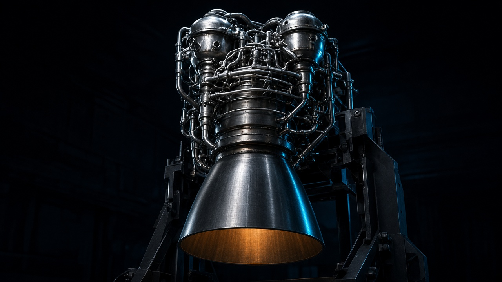

# How full-flow staged combustion works

A Raptor-inspired sectional model of the closed cycle that runs both propellants through turbines, then finishes the burn in one chamber. The film is 34 seconds. It does not invent a chamber pressure.

Editorial rendering for the header. Two housings, one chamber, one bell. It is not a photograph of a flight Raptor and not the sectional model in the player.

## The cycle in one paragraph

A full-flow staged combustion engine burns its propellants twice on purpose. A small burn in each preburner drives that propellant's turbine. The turbine exhaust is still mostly unburned propellant, so it is ducted into the main chamber and burned there. Nothing in this cycle is thrown overboard to spin the pumps.

That routing is the idea. Thrust still comes from hot gas leaving a nozzle. The machinery above the nozzle exists to raise propellant pressure without wasting the drive gas, and to do it on two separate shafts so fuel-rich gas and oxidizer-rich gas do not have to share one rotor.

This piece walks the same five beats as the film: feeds and pumps, two preburners, turbine gas into the chamber, chamber burn with regenerative cooling, and nozzle expansion. The subject is the methalox version of the cycle, the family SpaceX's Raptor flies. The plate is a conceptual section. It is not a drawing of a specific Raptor serial number, and it is not a certified engineering reference.

## What "full-flow" claims

Staged combustion means some of the burning happens before the main chamber, in preburners that power the turbines.

Full-flow means both propellants take that path. One preburner runs fuel-rich. The other runs oxidizer-rich. Each drives only its own turbopump. The two hot streams meet in the main chamber.

Neighboring cycles make the distinction concrete. The comparison is about where the drive gas goes. It is not a ranking of efficiency, thrust, or reliability.

| Cycle | What drives the turbines | Where the turbine exhaust goes |
| --- | --- | --- |
| Gas generator, open cycle | A small burned stream | Overboard, beside the nozzle |
| Fuel-rich staged combustion | Fuel-rich preburner gas | Into the main chamber |
| Oxidizer-rich staged combustion | Oxidizer-rich preburner gas | Into the main chamber |
| Full-flow staged combustion | Both of the above, on separate shafts | Both streams into the main chamber |

The open cycle is the simpler machine, and it throws away the turbine drive gas. Staged combustion keeps that gas and burns it. Full-flow does this for both propellants, so the main chamber injects gas into gas.

Felix Becker's public walkthrough, "How SpaceX's Raptor works, one problem at a time" (becker.so/raptor, September 2026), uses that topology and then prints chamber pressures and thrust figures for Raptor versions. A 2019 Wired report describes full-flow as the cycle on Raptor and describes earlier attempts as not having flown. Those pieces are explainers, not a released SpaceX cross-section. Where they add operating numbers, this project does not repeat the numbers as facts it established. Becker's pressure and thrust figures stay in his article. They are not on this plate.

## Stage 1: separate feeds, separate pumps

Liquid methane and liquid oxygen arrive on separate lines. At one atmosphere, methane boils near 112 K and oxygen near 90 K. Those are ordinary fluid properties, not engine operating points. The tanks are not drawn. The film starts where the engine plumbing starts.

Each liquid enters its own turbopump. A turbopump is a pump and a turbine on one shaft. The pump raises the liquid's pressure. The turbine is what will drive it, and that drive is the subject of a later shot. In the first five seconds the shafts are already visible, so the later energy path has a machine to land on. There are two shafts. The plate does not show a coaxial arrangement, and it does not show a rotational speed. The impellers and blade rows are section symbols. Their angle does not change with the frame, because a spinning marker would be read as an RPM this project does not have.

The camera moves from a wider view of the powerhead down onto the two pumps, and it keeps the preburners in the lower part of the frame. That is the causal link. The pumps are not a separate topic from the burners they feed.

## Stage 2: both propellants, two ratios

Each preburner receives both propellants. The split is intentionally lopsided, and the two preburners are lopsided in opposite directions.

The fuel-rich preburner takes most of the methane and a small oxidizer fraction. Its exhaust is hot, and it is still mostly fuel. The oxidizer-rich preburner takes most of the oxygen and a small fuel fraction. Its exhaust is hot, and it is still mostly oxidizer.

The bars beside the cans are marked schematic. Width means "most" or "a little." There is no mixture ratio on the figure. The main chamber runs at a third balance, when the two streams finally meet. That is why the preburners are not small copies of the main chamber.

The methane does not go straight from its pump into its preburner. In the teaching route for this cycle, pumped methane first passes through the wall channels of the chamber and nozzle, then into the fuel-rich preburner. Oxygen takes the shorter path from its pump to the oxidizer-rich preburner, with a thin cross-feed of each propellant into the other can. Flight hardware has changed across Raptor versions, including how much of that plumbing is visible on the outside. Treat the jacket order as the conceptual path.

The valves drawn on the cross-feeds are state marks. They read "open" for the steady run the film depicts. They are not a measured valve angle, and the film does not show the start sequence that would move them.

## Stage 3: turbine gas goes to the chamber

Gas leaves each preburner and enters its turbine. The turbine takes enthalpy out of the gas and delivers shaft work to the pump on that same spool. Gold marks that energy path. It is not a flame, not a torque number, and not a speed. The gold arrow points from the turbine up toward the pump and then holds still.

After the turbine, the gas is still propellant. In a gas-generator cycle this is where a duct would turn overboard. Here both ducts turn inward, to the injector. The fuel-rich stream and the oxidizer-rich stream enter the main chamber as gases. The camera follows those ducts while the turbines remain in frame. Same gas, two jobs: turn the shaft, then burn.

Violet marks state, not a sensor brand. A tap on the chamber wall and a tap near the injector mean "this is the kind of place a pressure or temperature measurement lives." The plate shows no value. A value would be invented.

The injector is a face with a row of ports. It is not a claimed element pattern. Coaxial, pintle, and swirl arrangements are real injector families. This drawing does not pick one.

## Stage 4: steady burn, cooled wall

The two gases meet and burn. The warm region inside the chamber is a mark so the gas is not mistaken for metal. The caption calls it steady combustion. That is deflagration. It is not a detonation. Detonation is a supersonic, shock-coupled reaction. This chamber is a continuous burner. The drawing also refuses to fake turbulence, mixing length, or an injector element it cannot represent faithfully.

The wall would not survive that gas by material choice alone. Regenerative cooling runs the cold fuel through channels in the wall. Heat moves from the hot gas, through the liner, into the methane. The methane arrives at the fuel-rich preburner warmer than it left the pump. The arrows are a steady-state schematic. Startup, shutdown, and boiling crisis are not modeled. The film labels that limit as time compression.

Channel height is exaggerated, and an inset enlarges the wall further. Both are labeled as a scale change. The liner alloy is not named. "High-conductivity liner" is as far as the plate goes. Hot oxygen-rich gas is aggressive toward metal, which is why oxidizer-rich turbines are a materials problem and not only a plumbing problem. This page does not name the alloy.

The shot is also labeled slow motion. A chamber residence time is on the order of milliseconds. A label cannot be read in a millisecond, so the clock of the film is not the clock of the gas. The moving dashes on the pathways are a direction cue. They are not scaled to a real velocity. That sentence applies to every chapter, and it matters most here, where a viewer could mistake the dash speed for a flow speed.

## Stage 5: the nozzle

Upstream of the throat, the contour converges. At the throat it is narrowest. Downstream it opens into a bell. For a choked de Laval nozzle the standard relation is subsonic in the chamber, sonic at the throat, and supersonic in the bell. The inset states those regimes and does not state a Mach number. Arrow length is not used as a fake velocity scale. The centerline dash continues, still as a direction cue.

The bell contour is a teaching shape. It is smooth, it has a throat, and it opens. It is not a Rao contour for a named engine, and it is not a measured Raptor nozzle. The boundary drawn past the exit is an illustration of a plume edge, in the same cyan used for other explanatory marks, so it is not mistaken for a photograph of fire. Drawing shock diamonds would imply a specific pressure ratio. This model does not have one.

The camera travels down the bell, then eases back until the pumps, preburners, chamber, and nozzle sit in one frame. The last stretch, from frame 980 through frame 1019, is held still. The player stops there. It does not loop, because a loop would throw away the only moment when the whole path can be read at once.

## What the model refuses

- Chamber pressure, turbine speed, gimbal angle, mixture ratio, thrust, specific impulse, and mass flow.
- A coaxial dual-pump rotor. Each propellant has its own shaft.
- Ignition sequence, valve timing, and startup transients. The run drawn here is steady.
- Tank pressurization taps, including autogenous gas returned to the tanks.
- A specific Raptor version's external plumbing, materials, or injector.
- Any claim that the cycle is the most efficient in a ranked sense. Keeping the turbine gas is a routing fact. A ranking needs a propellant, an altitude, a nozzle, and a measured specific impulse. None of that is asserted here.
- Gimbaling. Thrust vectoring is omitted rather than drawn at an invented angle.

## Why the cycle is hard, without the brochure

Two preburners have to stay in balance. Each turbine has to supply the pump work for its own propellant, and the two mixture ratios have to leave the right residual propellants for the main chamber. The plate shows the existence of that coupling. It does not show a control law.

The oxidizer side adds a materials constraint the fuel side does not. The turbine gas is mostly hot oxygen. The fuel side, on methane, avoids the coking reputation of kerosene, and this page does not turn that qualitative comparison into a life number.

Becker also notes that a running full-flow engine feeds itself: the preburners make the gas that spins the pumps that feed the preburners. Starting from a dead stop is a different problem, and he writes that SpaceX has not published Raptor's start sequence. This film does not invent one. The badge on the first chapter says the steady run is what is drawn.

## How to watch the film

The player is frame-locked. Frame 510 is the same picture every time you land on it. Scrub, or jump with keys 1 through 5. Cyan is the propellant path. Gold is shaft work and the heat path. Violet is sensing or state. Hardware stays in the metal color. If a panel says schematic, it is a diagram sitting beside the hardware.

Prefers-reduced-motion stops autoplay. The chapter text is in the page, not only inside the canvas, so the explanation survives without the drawing. The canvas pauses when it is off screen.

The path motion is the only thing that changes inside the machine. Parts do not fly apart. A section cut is not an exploded view. If a mechanism could not be drawn without pretending, it became a labeled schematic or it was left out.

## Sources and review status

Cycle topology used here: two preburners, two turbopumps, turbine exhaust injected into the main chamber, methane as the regenerative coolant in the methalox teaching route. Read against Becker's September 2026 explainer at becker.so/raptor, which states the full-flow split in those terms and dates Raptor's first flight to Starhopper in July 2019 after the RD-270 and the Integrated Powerhead Demonstrator. The Wired report at wired.com/story/spacex-raptor-engine-starship/ is the earlier popular account that full-flow had been tried twice before and had not flown. Confirm the flight date against a primary source before you depend on it in anything that has to be exact.

This is a consolidated working brief turned into a film and an essay. It is not a certified engineering reference. Verify the subject before publication, design use, or any claim about a flight engine. The source brief also carries a medical-review line written for a series that includes clinical topics. This page is aerospace. It is not clinical instruction.

Nothing here collects an address, a measurement, or an account. The player runs in the browser from the frame index. There is no analytics tag on the page.

## Questions people actually ask

### What is full-flow staged combustion?

It is a closed rocket cycle with two preburners. One runs fuel-rich and drives the fuel turbopump. One runs oxidizer-rich and drives the oxidizer turbopump. Both turbine streams then enter the main chamber and finish burning. Full-flow means both propellants take a turbine path, rather than only one of them.

### How is it different from a gas-generator cycle?

A gas-generator cycle burns a little propellant to spin the turbines and dumps that gas overboard. Staged combustion ducts the turbine exhaust into the main chamber and burns it there. Full-flow staged combustion does that with two preburners, one for each propellant.

### Why are there two preburners?

So each turbopump can be driven by gas that is already rich in its own propellant. The fuel turbine sees fuel-rich gas. The oxidizer turbine sees oxidizer-rich gas. The plate shows two shafts for that reason. It does not show a coaxial dual-pump rotor.

### Where does regenerative cooling sit in the path?

In the teaching route drawn here, pumped liquid methane flows through channels in the chamber and nozzle wall before it reaches the fuel-rich preburner. The methane picks up wall heat. The oxidizer goes from its pump to the oxidizer-rich preburner. Flight plumbing differs by engine version, so the drawing is labeled as a route, not as a tube map of one serial number.

### Is the chamber combustion a detonation?

No. The chamber in this cycle is a continuous burner. The reaction is deflagration. Detonation is a supersonic, shock-coupled reaction, and nothing on this plate is drawn that way.

### Why are there no pressures, speeds, or mixture ratios?

The source brief forbids invented pressures, rotational speeds, gimbal angles, and a coaxial pump arrangement. Public explainers sometimes print those figures. This project did not measure them, so the plate and this article do not adopt them. Bar widths mean most or a little.

### Is this a drawing of a flight Raptor?

It is a Raptor-inspired conceptual model of the full-flow methalox cycle. It is not a dimensioned cross-section of Raptor 1, 2, or 3. SpaceX has not published the drawing this plate would have to match. The editorial photograph is a rendering of an engine on a stand, not flight hardware.
